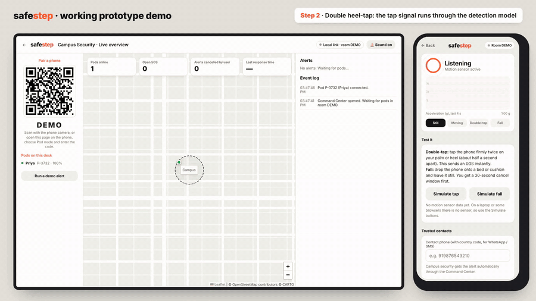
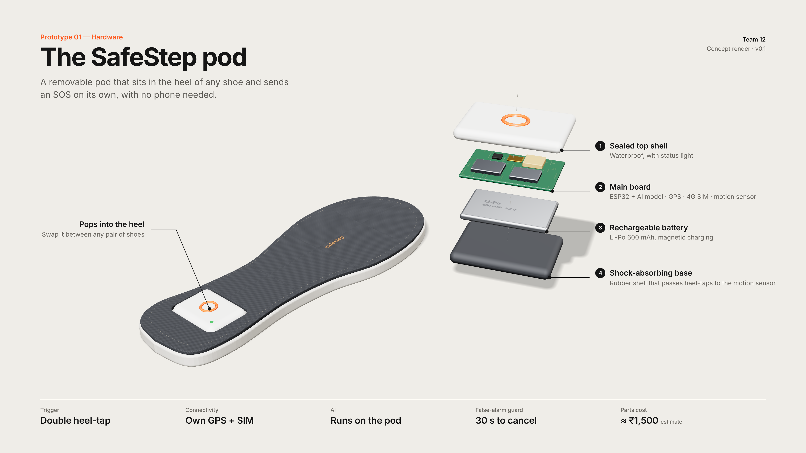
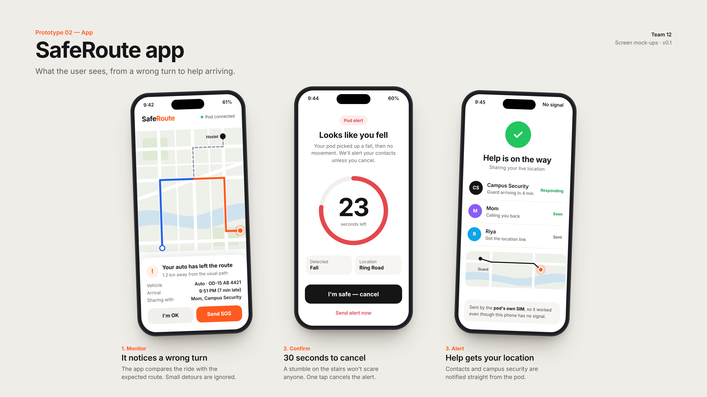
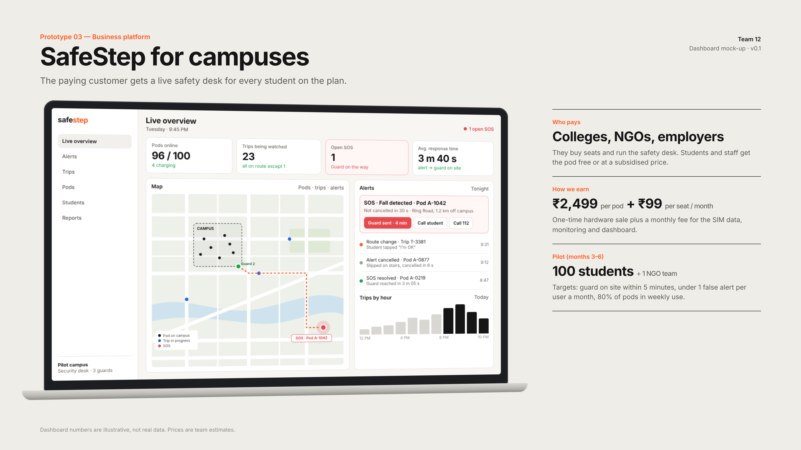
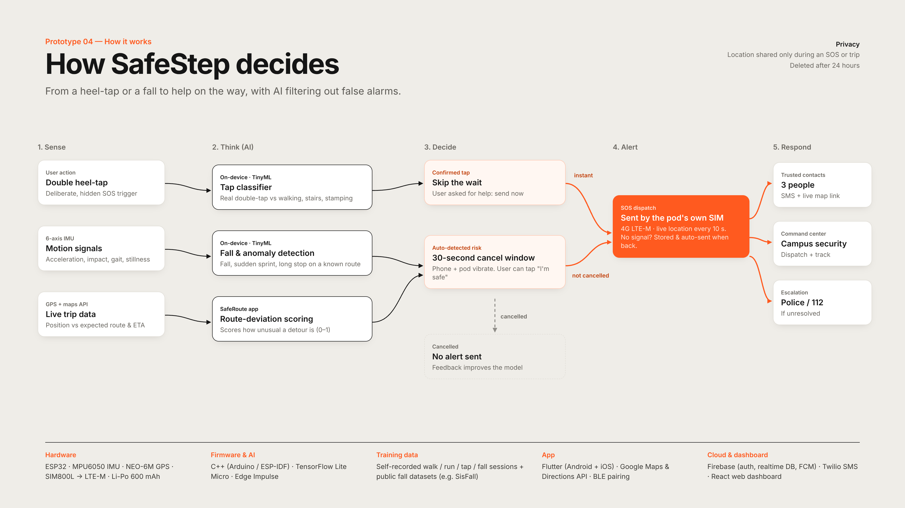

# SafeStep 👟📡

**An AI-enabled smart insole that calls for help even when you can't.**

A removable pod in the heel of any shoe, with its own GPS and SIM. A double heel-tap sends a silent SOS with live location, and on-device AI detects a fall or danger and alerts automatically. Its companion app, **SafeRoute**, flags shared-auto and cab rides that leave their planned route.

🔗 **Live prototype:** https://superb-dodol-78b5ea.netlify.app
🎥 **Demo video:** [`assets/SafeStep_Prototype_Demo.mp4`](assets/SafeStep_Prototype_Demo.mp4)

> Built by Team 12 for the *Innovation and Entrepreneurship* course (Group Assignment A2), BS Data Science & AI, IIM Sambalpur.

---

## The problem

Almost every personal-safety tool (helpline apps, ride-app SOS buttons, smart pendants) depends on a working phone. In a real emergency, the phone is often the first thing to be snatched, switched off or dead.

- **4,48,211** cases of crime against women were registered in India in 2023 (NCRB, *Crime in India 2023*)
- Only **9%** of women feel public transport is "very safe" (Ola Mobility Institute, 9,935 women, 11 cities)
- **77%** of women feel unsafe on Delhi buses after dark (Greenpeace India, 2024)

## What SafeStep does

| Feature | How it works |
|---|---|
| **Silent heel-tap SOS** | A deliberate double tap sends an alert with live location, with no phone needed |
| **AI danger detection** | Detects a fall (free-fall → impact → stillness) and alerts even if the user can't act |
| **30-second cancel window** | Automatic alerts can be cancelled, so a stumble never scares anyone |
| **Own GPS + 4G SIM** | Works when the phone is lost or dead; stores the alert and sends it when signal returns |
| **SafeRoute** | Scores how far and how long a ride strays from its planned route; ignores normal detours |
| **Campus Command Center** | A live dashboard where security sees alerts, dispatches a guard, and the user is notified |
| **Privacy by design** | Location is shared only during an SOS or trip and deleted after 24 hours |

## Try the working prototype

The prototype is a single web page with three modes:

1. On a **laptop**, open the [live prototype](https://superb-dodol-78b5ea.netlify.app) → **Command Center**, then click **Turn sound on**.
2. On a **phone**, scan the QR code shown on the Command Center → enter a name → **Start pod** → allow Motion and Location.
3. **Double-tap** the phone firmly on your palm. The SOS appears on the Command Center within a second.
4. Click **Dispatch guard**. The phone shows *"Responding · ETA 4 min"*.
5. Drop the phone onto a cushion and leave it still. The 30-second fall countdown starts.
6. Back on the laptop, open **SafeRoute trip** → **Start ride** to watch the route-deviation check fire.

No phone sensor? Use the **Simulate tap** and **Simulate fall** buttons, which feed a realistic signal through the same detector.

## How it works

**Sense → Think → Decide → Alert → Respond**

- **Tap detection:** two sharp acceleration peaks (above 1.25 g deviation) 150–700 ms apart, with low background movement. Longer bursts are classified as walking or running.
- **Fall detection:** free-fall (below 0.45 g for more than 60 ms), then impact (above 2.3 g) within 1 s, then stillness (standard deviation below 0.12 g) for about 1.5 s.
- **Route deviation:** distance from the planned route polyline, combined with time spent off route, into a 0–1 score; the alert fires above 0.7.
- **Realtime link:** pod ↔ Command Center messages travel over an [ntfy.sh](https://ntfy.sh) topic per pairing code (plus `BroadcastChannel` for tabs in the same browser).

## Functional prototype vs final product

| | Final product (physical pod) | This prototype |
|---|---|---|
| Where it runs | Pod inside the shoe's heel | A phone running this web app |
| Motion sensing | MPU6050 6-axis IMU | The phone's motion sensor (`DeviceMotionEvent`) |
| Location | NEO-6M GPS module | The phone's GPS (Geolocation API) |
| Sending the SOS | 4G LTE-M module with its own SIM | The phone's internet connection |
| Detection model | TinyML model on an ESP32 (TensorFlow Lite Micro / Edge Impulse) | Rule-based classifier on the motion signal |
| Works without a phone? | Yes | No, the phone *is* the pod here |

## Tech stack

**Prototype:** HTML, CSS, JavaScript · Leaflet (maps, CARTO tiles) · `qrcode-generator` · ntfy.sh (realtime relay) · Device Motion and Geolocation APIs · hosted on Netlify

**Planned product:** ESP32 · MPU6050 · NEO-6M GPS · SIM800L → 4G LTE-M · Li-Po 600 mAh · TensorFlow Lite Micro · Edge Impulse · SisFall dataset · Flutter app · Google Maps API · Firebase · Twilio SMS

## Business model (team estimates)

- **B2B2C:** colleges, NGOs and employers pay through safety or CSR budgets; students and field workers use it
- About **₹1,500** parts cost per pod; **₹2,499** retail, plus **₹99 per seat per month** for SIM data, monitoring and the dashboard
- **Roadmap:** build and test the pod (months 0–3) → pilot with 100 students and 1 NGO field team (months 3–6) → footwear-brand partner and CSR funding (months 6–12)

## Repository contents

| File | What it is |
|---|---|
| `index.html` | The complete working prototype (one self-contained file) |
| `assets/` | Prototype visuals and demo video |
| `docs/` | Concept note and presentation |

## Team 12

Avidha Chandra · Agrima · Anirudh Kumar · Yuvraj Rao Padala · Divyansh Sinha · Pratyush Phadnaik · Shreyam Sai Vinayak · Aayush Agrawal

*Innovation and Entrepreneurship · IIM Sambalpur · 2026*
